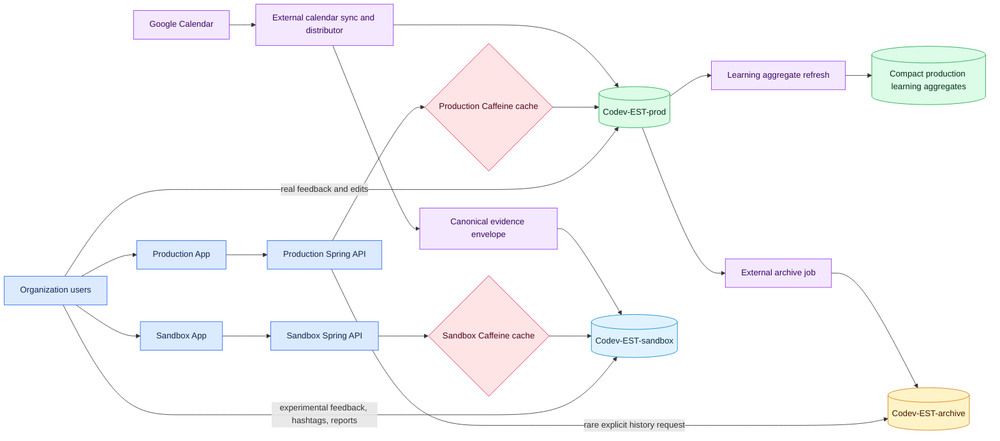

# EST hot data, archive, and caching plan

## Status

This document is both the implementation plan and the resource registry for the three Neon tracks.

The projects now exist:

| Track | Neon project | Project ID | Default branch | Purpose |
|---|---|---|---|---|
| Production | `Codev-EST-prod` | `fragrant-cloud-37068465` | `production` | Real accounts, calendar credentials, authoritative feedback |
| Sandbox | `Codev-EST-sandbox` | `flat-breeze-15814484` | `sandbox` | Real calendar evidence with isolated experimental edits |
| Archive | `Codev-EST-archive` | `dry-cloud-96538248` | `archive` | Verified cold evidence and historical payloads |

Production is the renamed original `Codev-EST` project. The sandbox project has the current EST
Flyway schema, and the archive project has the archive-only Flyway schema. A manual, idempotent
production-to-sandbox evidence distributor is implemented and verified; scheduling it and adding a
durable replication ledger remain planned work. The application does not yet use an application
cache.

## Executive decision

EST should evolve in this order:

1. Keep production authoritative for identity, credentials, and real feedback.
2. Replicate canonical calendar evidence from production into sandbox.
3. Keep every manual sandbox write isolated from production.
4. Measure storage, transfer, query volume, and latency before adding caching.
5. Add a bounded in-process Caffeine cache for safe, read-heavy data.
6. Build compact historical learning aggregates in production.
7. Move only bulky, old calendar evidence to the archive project.
8. Add managed Redis or Valkey only if EST runs multiple API instances or needs a shared cache.

Authoritative session records remain in the primary Neon project. The archive is not part of the
normal request path, and the application must never depend on a cross-database join to render Today,
Inbox, Timeline, or a session form.

Sandbox is not a branch that is periodically reset from production. A reset would erase the
experiments the sandbox exists to preserve. It is a separate project that receives idempotent
calendar-evidence replication while keeping its own candidates, suggestions, sessions, catalog
changes, hashtags, feedback, and reports.

## Quota assumptions

The architectural decision must start from the correct quota dimensions:

- Neon Free currently provides database storage per project.
- Public network transfer is a separate monthly project allowance.
- Compute is limited separately.
- A read replica copies the same project data and is not an archive.
- A PostgreSQL partition remains in the same project and does not isolate project quotas.
- A separate Neon project separates project-level storage, transfer, and compute usage.

The values previously reviewed for this pilot were 1 GB of storage and 5 GB of public transfer per
project per month. These are plan assumptions, not constants. Confirm the current limits in the Neon
console before starting Phase 6 and again before relying on a second project.

Creating projects to multiply free allowances is suitable for an internal pilot, but it is not a
permanent production scaling strategy.

## Current constraints

EST has three data layers that must remain separate:

1. `calendar_events` are provider evidence and are written only by calendar synchronization.
2. `candidates` and `suggestions` are proposals that require a decision.
3. `sessions` and their children are authoritative, member-owned records with field provenance.

Other important constraints:

- Every read and write is scoped by organization.
- Manual session fields must never be overwritten by sync, AI, cache refresh, or archival.
- Google tokens, refresh tokens, decrypted credentials, and sensitive token fields must never enter
  a cache or archive payload.
- The Devin App machine is not durable infrastructure.
- Calendar synchronization and archival run outside the web/API process.
- Neon PostgreSQL remains the source of truth.

## Three-track target architecture



## Production and sandbox isolation

### Shared starting evidence

Production and sandbox receive the same canonical upcoming calendar evidence:

- Stable provider event identity.
- Title, description, start, end, location, and conferencing details.
- Organizer and attendee evidence.
- Provider status, ETag, and content hash. The initial distributor omits the raw provider payload.
- The organization member who owns the calendar.
- The sync run and replication metadata needed for idempotency.

The distributor fetches from Google once through the production identity. It then writes the
canonical event to production and independently replicates the same envelope to sandbox.

### Production-only state

- Google calendar refresh tokens and sync cursors.
- OAuth link state and calendar-linking operations.
- Authoritative candidates, decisions, suggestions, sessions, feedback, and reports.
- Production catalog and hashtag changes.
- Production audit records.

### Sandbox-only state

- Experimental candidate decisions and suggestion decisions.
- Experimental sessions and repeated feedback attempts.
- Experimental catalog items, hashtags, client mappings, and report definitions.
- Sandbox audit records.
- Sandbox cache contents.

Sandbox must not store Google calendar refresh tokens. Team members use real Google sign-in for
identity, but calendar linking and direct Google sync are disabled there. Calendar evidence arrives
only from the distributor.

### Never replicate back to production

No sandbox-originated write may flow into production automatically. Promotion, if ever required,
must be an explicit reviewed export/import operation with a human-readable diff.

## Calendar evidence distribution

The external calendar job owns a canonical, versioned envelope:

```text
CalendarEvidenceEnvelope
  schemaVersion
  organizationKey
  ownerGoogleSubject
  ownerEmail
  provider
  providerEventId
  event fields
  attendees
  sourceETag
  contentHash
  sourceSyncedAt
```

The envelope uses Google subject and normalized email as cross-environment identity keys. The
initial distributor preserves matching production IDs in sandbox for simple foreign-key alignment,
but the envelope contract must not depend on those IDs remaining identical forever.

For each envelope:

1. Resolve the production member and identity.
2. Upsert production evidence and run the normal production candidate analysis.
3. Resolve or provision the corresponding sandbox member by Google subject or email.
4. Upsert a tokenless sandbox identity record.
5. Upsert sandbox evidence.
6. Create sandbox candidates and suggestions only when that event has no sandbox-owned state.
7. Record separate production and sandbox outcomes in a replication ledger.
8. Retry only the failed target using the same envelope and idempotency key.

The distributor must never copy production `sessions`, candidate decisions, suggestion decisions,
catalog edits, refresh tokens, or token families into sandbox.

## Environment identity and visible safety

Every running app must declare:

```text
EST_TRACK=prod|sandbox
EST_CALENDAR_SYNC_ENABLED=true|false
```

The frontend must show a persistent environment label. Sandbox uses a visually distinct banner and
language that says experimental changes never affect production. Production must not use a playful
or ambiguous label.

Recommended behavior:

| Capability | Production | Sandbox | Archive |
|---|---:|---:|---:|
| Real Google sign-in | Yes | Yes | No app |
| Calendar linking | Yes | No | No |
| Direct Google sync | Yes, through external job or manual recovery | No | No |
| Replicated calendar evidence | Source | Target | Historical target |
| Manual feedback | Authoritative | Experimental | No |
| Catalog and hashtag edits | Authoritative | Experimental | No |
| Session/report generation | Authoritative | Experimental | Historical retrieval only |

## Hot database boundary

The primary Neon project should contain everything needed for normal interactive use.

### Always keep hot

- Organizations, members, identities, and authorization state.
- Clients, teams, people, domains, and reference catalog items.
- All authoritative `sessions`.
- Session contacts, participants, technologies, use cases, and provenance.
- Upcoming calendar events.
- Recent calendar events needed for Inbox, deduplication, replay, and corrections.
- Open candidates and undecided suggestions.
- Sync cursors and identity state required for idempotent incremental sync.
- Compact learning aggregates used to prefill new sessions.
- Lightweight references to archived evidence.
- Audit records required by the active retention policy.

### Recommended initial hot window

Keep all future events and the previous 90 days of calendar evidence in the primary project.

Make the lookback configurable:

```text
EST_HOT_EVENT_LOOKBACK_DAYS=90
```

Do not archive solely because a row is old. A row is archive-eligible only when every applicable
condition is true:

- Its event ended before the configured cutoff.
- It is not attached to an open candidate.
- It is not needed by an undecided suggestion.
- It is not needed for active sync deduplication or replay.
- Its compact learning features have been refreshed successfully.
- Its archive copy has been verified.

## Archive boundary

The first archive implementation should move bulky evidence, not authoritative sessions.

### Archive first

- Old raw Google provider payloads from `calendar_events.raw`.
- Old calendar descriptions after redaction and policy review.
- Old conferencing and location details when no longer operationally useful.
- Historical attendee payloads.
- Completed sync-run details and large error payloads after the operational retention period.

### Keep a lightweight hot envelope

Deleting an entire `calendar_events` row is risky because `candidates` and
`session_source_events` reference it. The first archive design should retain a small hot record with:

- Stable event ID.
- Organization, identity, and owner IDs.
- Provider event ID.
- Start and end time.
- Content hash and status.
- Archive state, location, version, and checksum.
- Timestamps required for audit and idempotency.

The archive job can then remove or replace bulky fields only after verification. This preserves
referential integrity and avoids cross-project joins in normal requests.

### Do not archive initially

- `sessions` or session child records.
- Members, clients, people, or catalog data.
- Open candidates.
- Proposed or undecided suggestions.
- Authentication, OAuth, or token records.
- Data required to enforce organization boundaries.

## Archive option analysis

| Option | Benefits | Drawbacks | Decision |
|---|---|---|---|
| PostgreSQL partition | Simple SQL, one transaction boundary, easier querying | Same project storage, transfer, and compute limits | Use only if query performance needs it |
| Neon read replica | Reduces read pressure on the primary compute | Copies the same data, shares the project boundary, not cold storage | Reject for archival |
| Separate Neon project | Isolates project-level quotas and creates a clear hot/archive boundary | No cross-project joins, more credentials, migrations, monitoring, and security work | Preferred pilot archive |
| Object storage | Compressed, inexpensive long-term storage for rarely queried payloads | Harder ad hoc queries and restoration | Revisit after the archive format stabilizes |

## Archive data model

### Hot project additions

Introduce Flyway migrations for fields or a companion table equivalent to:

```text
calendar_event_archive_refs
  event_id
  organization_id
  archive_store
  archive_key
  archive_version
  archived_at
  payload_checksum
  payload_bytes
  status
  last_error
```

Suggested states:

```text
eligible -> copying -> verified -> compacted
                     \-> failed
```

`failed` rows remain fully available in the hot project and can be retried safely.

### Archive project tables

Start with an append-safe envelope:

```text
archived_calendar_evidence
  event_id
  organization_id
  owner_member_id
  source_identity_id
  occurred_at
  archived_at
  schema_version
  payload_json
  payload_checksum
```

Use a stable primary key such as `(organization_id, event_id, schema_version)`. Archive writes must
be idempotent upserts.

Do not copy encrypted Google credentials, refresh tokens, access tokens, or authentication state.

## Archive job algorithm

The archive job runs as a separate Devin Automation or platform-independent scheduled job.

For each bounded batch:

1. Select eligible rows using organization scope, cutoff, and stable ordering.
2. Acquire a lease or mark the rows `copying`.
3. Redact fields that are not allowed in the archive.
4. Build a versioned archive envelope.
5. Upsert the envelope into the archive project.
6. Read the archive row back and verify its checksum and required metadata.
7. Refresh the compact learning aggregates.
8. Mark the hot row `verified`.
9. Compact only the approved bulky fields.
10. Mark the row `compacted`.
11. Write an audit event with counts, bytes, cutoff, and job ID.

The source row must not be compacted when copying, verification, aggregation, or auditing fails.

Suggested controls:

```text
EST_ARCHIVE_ENABLED=false
EST_ARCHIVE_CUTOFF_DAYS=90
EST_ARCHIVE_BATCH_SIZE=250
EST_ARCHIVE_MAX_BATCHES=4
EST_ARCHIVE_DRY_RUN=true
```

Start weekly. Increase frequency only if measured growth requires it.

## Learning aggregates

EST should not query the archive during normal form prefilling. Before evidence is compacted, derive
small records that answer the product's recurring learning questions.

Examples by organization and client:

- Most frequently used technologies.
- Common contacts and their roles.
- Session type counts.
- Outcome counts.
- Common use-case types.
- Last-session date.
- Recent facilitator counts.
- Evidence count and last refresh time.

Possible tables:

```text
client_learning_stats
client_contact_stats
client_technology_stats
```

Every aggregate row must include `organization_id`. Refreshes must be deterministic and repeatable.
The aggregate result may cite archived event IDs, but normal rendering must not require an archive
lookup.

## Caching decision

### Start with Caffeine

The current Devin App runs one Spring API process. Use a bounded Caffeine cache inside that process
before introducing Redis.

Benefits:

- No new network dependency.
- Very low latency.
- Simple deployment and rollback.
- Appropriate for one API instance.
- Cache loss is harmless because Neon remains the source of truth.

Limitations:

- Cleared when the process restarts or the App wakes on a new process.
- Not shared between multiple API instances.
- Memory is limited by the App machine.
- Requires explicit invalidation to avoid stale data.

These limitations are acceptable for the pilot.

### Do not run local Redis as durable infrastructure

Redis on the Devin App machine can disappear when the process or session changes. It also adds a
second process without coordinating multiple API instances. If a shared cache is later justified,
use a managed Redis or Valkey service.

### Cache candidates

Cache only read-heavy, reconstructible results:

- Reference catalogs by organization.
- Client, team, and person lookup lists by organization.
- Historical learning aggregates by organization and client.
- Expensive, read-only snapshot fragments with a member-aware key.
- Feature configuration that contains no credentials.

### Do not cache

- Google access or refresh tokens.
- EST refresh tokens or token families.
- Decrypted identity credentials.
- Raw calendar descriptions or provider payloads.
- Authorization decisions beyond a very short request-level lifetime.
- Open transaction state.
- Unredacted sensitive text.

### Suggested TTLs

| Data | Initial TTL | Invalidation |
|---|---:|---|
| Upcoming session summary | 5 minutes | Session write, calendar sync |
| Today and Inbox snapshot fragment | 5 minutes | Session write, sync, candidate decision |
| Catalog items | 1 hour | Admin catalog write |
| Client, team, and people lookups | 30 minutes | Corresponding write |
| Learning aggregates | 2 hours | Aggregate refresh, archive completion |
| Feature configuration | 5 minutes | Configuration change or restart |

TTL is a safety net, not the primary consistency mechanism. Successful writes should evict affected
keys immediately.

### Cache key rules

Every cache key must contain the organization ID. Member-specific results must also contain the
member ID and all material filters.

Example:

```text
snapshot:{organizationId}:{memberId}:{fromDate}:{toDate}
learning:{organizationId}:{clientId}:{aggregateVersion}
catalog:{organizationId}:{kind}:{includeArchived}
```

Never derive a cache key from email alone.

### Memory controls

Use maximum size or maximum weight, expiry, and cache metrics. Do not allow an unbounded cache.

Suggested initial limits:

```text
EST_CACHE_ENABLED=false
EST_CACHE_MAX_ENTRIES=1000
EST_CACHE_SNAPSHOT_TTL=PT5M
EST_CACHE_CATALOG_TTL=PT1H
EST_CACHE_LEARNING_TTL=PT2H
```

## When to introduce managed Redis or Valkey

Add an external shared cache only when at least one of these is true:

- EST runs more than one Spring API instance.
- Cache coherence across instances is required.
- Database latency or transfer remains material after query and Caffeine improvements.
- A rate limiter, distributed lock, queue, or shared ephemeral state has a justified use case.

Even then:

- Neon remains the source of truth.
- Redis is allowed to lose all data.
- Cache values remain redacted and organization-scoped.
- Writes invalidate or version keys.
- Authentication tokens remain outside the cache unless a separate security design explicitly
  approves them.

## Phased delivery

### Phase 0: establish hard track boundaries

Goal: make it visually and operationally difficult to confuse production and sandbox.

Work:

- Add `EST_TRACK` and `EST_CALENDAR_SYNC_ENABLED` configuration.
- Add `prod` and `sandbox` application profiles.
- Display a persistent track label in the web UI.
- Disable calendar linking, unlinking, and direct sync in sandbox.
- Keep real Google sign-in available in both user-facing tracks.
- Document the three project IDs, branches, owners, and secret names.
- Apply the normal EST Flyway schema to sandbox.
- Add archive-only Flyway migrations before writing archive data.

Exit gate:

- A sandbox user cannot call calendar linking or direct sync endpoints.
- Production and sandbox are unmistakable in the UI.
- The archive project exposes no EST web/API process.
- Credentials are separate and absent from Git.

Rollback:

- Point the App back to the production environment file and disable the sandbox deployment.

### Phase 1: build calendar evidence distribution

Goal: give both tracks the same upcoming calendar evidence without sharing manual state.

Work:

- Define and version `CalendarEvidenceEnvelope`.
- Fetch Google once using production-owned credentials.
- Resolve users across environments by Google subject and normalized email.
- Store tokenless shadow identities in sandbox.
- Upsert evidence independently in production and sandbox.
- Create sandbox candidates and suggestions only when no sandbox-owned state exists.
- Add an idempotent replication ledger with per-target status and retry.
- Add a dry-run mode that reports changes without writing them.
- Prove that sandbox sessions, feedback, catalogs, and hashtags never flow to production.

Exit gate:

- The same provider event and content hash appear in both tracks.
- Retrying a delivery creates no duplicates.
- A sandbox edit survives later evidence refreshes.
- A failed sandbox delivery does not roll back a successful production sync.
- No Google refresh token exists in sandbox.

Rollback:

- Disable the sandbox target in the distributor. Production sync continues normally.

### Phase 2: measure and set thresholds

Goal: prove which resource is constrained before changing the architecture.

Work:

- Record Neon storage, public transfer, compute, active connections, and slow queries weekly.
- Add application metrics for repository call counts, query latency, response size, and cacheable
  endpoint frequency.
- Measure the size of raw event payloads, attendee rows, descriptions, sessions, and audit data.
- Identify the top queries behind `/snapshot`, Today, Inbox, Timeline, and Admin.
- Confirm current Neon plan limits.

Exit gate:

- At least one normal-usage baseline period is recorded.
- Archive-eligible bytes and expected monthly growth are known.
- A written threshold determines whether archival is justified.

Recommended trigger for Phase 6:

- Primary storage or public transfer reaches 60 percent of its allowance, or
- Archive-eligible evidence exceeds 30 percent of primary storage, or
- Forecasted growth reaches either condition within two months.

### Phase 3: reduce database work

Goal: get the easiest savings without adding state.

Work:

- Verify every list query selects only required columns.
- Add pagination or bounded date windows to historical views.
- Confirm indexes match organization, owner, status, and date filters.
- Keep `/snapshot` bounded to the data the UI needs.
- Avoid loading raw provider payloads in interactive reads.
- Add response compression if the hosting path does not already provide it.

Exit gate:

- Query plans are reviewed for the top read paths.
- No interactive endpoint reads `calendar_events.raw`.
- Baseline transfer and query counts improve or the remaining bottleneck is identified.

Rollback:

- Revert query changes; no data migration is involved.

### Phase 4: add Caffeine behind a feature flag

Goal: reduce repeated reads without creating new infrastructure.

Work:

- Add Spring cache support and Caffeine.
- Implement the approved cache keys and bounded memory settings.
- Cache catalogs and learning aggregates first.
- Add short-lived member snapshot fragments only after isolation tests pass.
- Evict on successful writes, sync completion, archive completion, and demo reset.
- Export hit rate, miss rate, eviction count, load time, and estimated size.

Exit gate:

- Cross-organization and cross-member isolation tests pass.
- Write-after-read tests prove immediate invalidation.
- Restart tests prove cache loss does not affect correctness.
- Database reads fall materially on repeated navigation.

Rollback:

- Set `EST_CACHE_ENABLED=false` and restart.

### Phase 5: add compact learning aggregates

Goal: preserve historical learning value without keeping bulky evidence in hot request paths.

Work:

- Add versioned aggregate tables through Flyway.
- Build a deterministic backfill.
- Compare aggregate-driven suggestions with current historical queries.
- Refresh aggregates after session writes and before archival compaction.
- Add a full rebuild command for recovery.

Exit gate:

- Aggregate results match the current source data within defined tolerances.
- Rebuilding produces the same result.
- Prefill and suggestion tests remain deterministic.

Rollback:

- Read from current source queries while retaining aggregate tables for diagnosis.

### Phase 6: add the archive schema and dry-run copying

Goal: validate isolation without deleting or compacting hot data.

Work:

- Use the provisioned `Codev-EST-archive` project.
- Apply archive-only Flyway migrations.
- Create least-privilege archive writer and archive reader roles.
- Add separate secrets for the external archive job and optional read-only application access.
- Implement versioned, idempotent copy and checksum verification.
- Run with `EST_ARCHIVE_DRY_RUN=true`, then copy-only mode.
- Compare counts, checksums, bytes, and organization scoping.

Exit gate:

- Repeated runs produce no duplicates.
- Failure injection leaves source data untouched.
- Archive credentials cannot access the hot project beyond their intended role.
- The App works normally when the archive project is unavailable.

Rollback:

- Disable the archive job. No hot data has been compacted.

### Phase 7: enable verified compaction

Goal: reduce hot storage while preserving normal EST behavior.

Work:

- Enable one organization and one small batch first.
- Compact raw payloads and other approved bulky fields only after verification.
- Keep lightweight hot envelopes and archive references.
- Add an explicit historical evidence endpoint only if users need it.
- Return a clear unavailable state when archive retrieval fails.
- Audit every batch and publish storage savings.

Exit gate:

- Today, Inbox, Timeline, session forms, sync, and suggestions behave unchanged.
- Archive retrieval works for authorized users.
- Storage and transfer reduction matches the forecast.
- Restore drills can reconstruct a compacted payload.

Rollback:

- Stop compaction.
- Restore payloads from verified archive envelopes by stable event ID.
- Continue operating from the hot database.

### Phase 8: evaluate shared caching and colder storage

Goal: add complexity only when measured usage justifies it.

Evaluate managed Redis or Valkey if EST runs multiple API instances. Evaluate object storage for
large evidence that is rarely queried. Evaluate paid Neon capacity before multiplying projects for
quota reasons.

## Security model

Use separate credentials and least-privilege roles:

| Principal | Production | Sandbox | Archive |
|---|---|---|---|
| Production EST application | Normal scoped application access | No access | No access initially; read-only if a history feature is added |
| Sandbox EST application | No access | Normal scoped application access, no calendar credentials | No access |
| Calendar distributor | Read calendar credentials and write evidence | Write tokenless identities and evidence | No access |
| Archive job | Read eligible evidence, update archive state, compact verified fields | No access | Upsert archive envelopes |
| Aggregate rebuild job | Read scoped sessions/evidence, write aggregate tables | Optional sandbox-local rebuild only | No access required |
| Operator | Audited administrative access | Audited administrative access | Audited administrative access |

Additional requirements:

- Store every project connection string in secret storage, never Git.
- Use different application, distributor, and archive credentials for each project.
- Never log either connection string.
- Keep organization scoping in every archive query and archive key.
- Treat sandbox as containing real personal and client data even though its manual records are
  experimental.
- Redact calendar payloads before transfer.
- Version the archive schema and payload envelope.
- Record who or what initiated each archive run.
- Apply retention and deletion policy to both projects.
- Do not cache credentials, raw tokens, or unredacted provider payloads.

## Testing strategy

### Unit tests

- Archive eligibility at cutoff boundaries.
- Open-candidate and undecided-suggestion exclusions.
- Redaction and archive-envelope versioning.
- Checksum generation.
- Cache key organization and member isolation.
- Cache invalidation after every supported write.
- Aggregate determinism.

### PostgreSQL integration tests

- Flyway migrations on real PostgreSQL.
- Idempotent archive upserts.
- Batch retry after partial failure.
- Source data remains intact when verification fails.
- Foreign-key safety for lightweight event envelopes.
- Organization isolation in hot and archive queries.

### End-to-end tests

- Sync creates evidence, candidates, and suggestions as before.
- Confirming a candidate creates a session without archive access.
- Manual edits survive sync and cache invalidation.
- Today, Inbox, Timeline, Calendar, and Admin work with the archive unavailable.
- A verified archive payload can be retrieved by an authorized user.
- Cache loss after process restart changes performance only, not behavior.

### Operational tests

- Disable cache at runtime and confirm direct reads.
- Deny archive network access and confirm normal App operation.
- Interrupt an archive batch and rerun it without duplicates.
- Restore a compacted payload into the hot project.
- Compare Neon storage and transfer before and after compaction.

## Observability

Track:

- Hot database bytes by table.
- Archive-eligible bytes.
- Archived and compacted bytes per run.
- Public transfer by project.
- Compute usage by project.
- Repository calls and query latency.
- `/snapshot` response bytes and latency.
- Caffeine hit, miss, eviction, load time, and size.
- Archive copy, verify, compact, failure, and retry counts.
- Aggregate refresh duration and lag.

Alerts:

- Archive job repeatedly fails.
- Archive verification mismatch occurs.
- Cache load failures rise.
- Primary storage or transfer exceeds the agreed threshold.
- Aggregate refresh lag exceeds its service target.
- Cross-organization access tests fail.

## Decisions intentionally deferred

- Exact archive retention period beyond the initial 90-day hot window.
- Whether descriptions are retained, redacted, or deleted after a legal and privacy review.
- Whether archive evidence needs an interactive UI.
- Whether object storage replaces the archive project for very cold payloads.
- Whether managed Redis or Valkey is needed.
- Whether paid Neon capacity is more economical than a second project.

## Definition of done

The architecture is complete when:

- EST remains correct with cache disabled or empty.
- Normal user requests do not require the archive project.
- All authoritative sessions remain in the hot project.
- Historical learning uses compact aggregates.
- Archive copying is idempotent and checksum-verified.
- Compaction happens only after verified copying and aggregate refresh.
- Organization isolation is tested in both projects.
- Storage and transfer savings are measured.
- Recovery and rollback have been exercised.

## Recommended next move

Finish Phase 0, then implement Phase 1 with mock calendar envelopes before enabling real Google
distribution. After isolation is proven, collect the Phase 2 baseline before adding Caffeine or
writing archive data. This sequence protects production while still giving the team a realistic
sandbox quickly.
